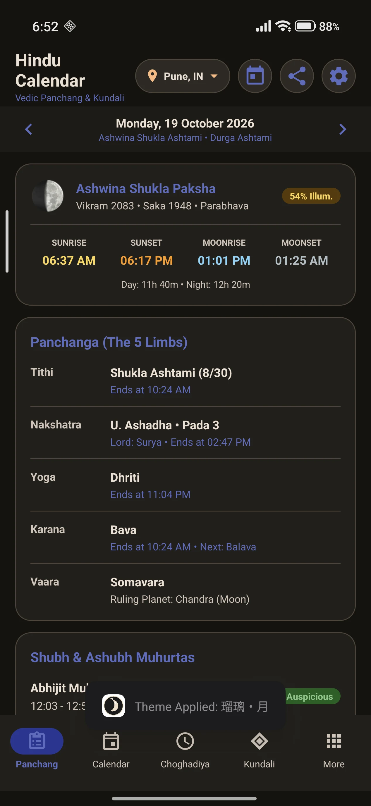
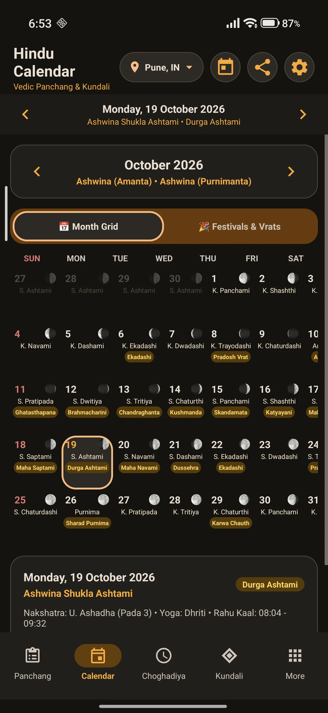
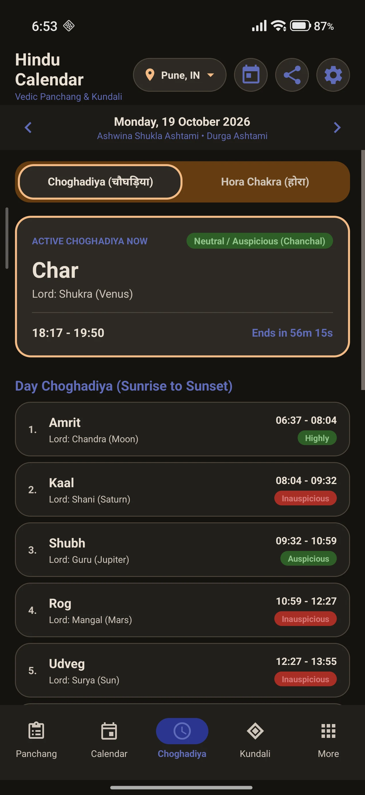
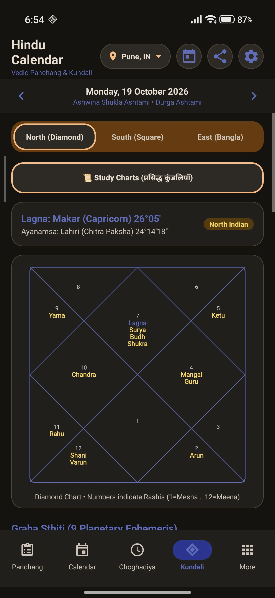
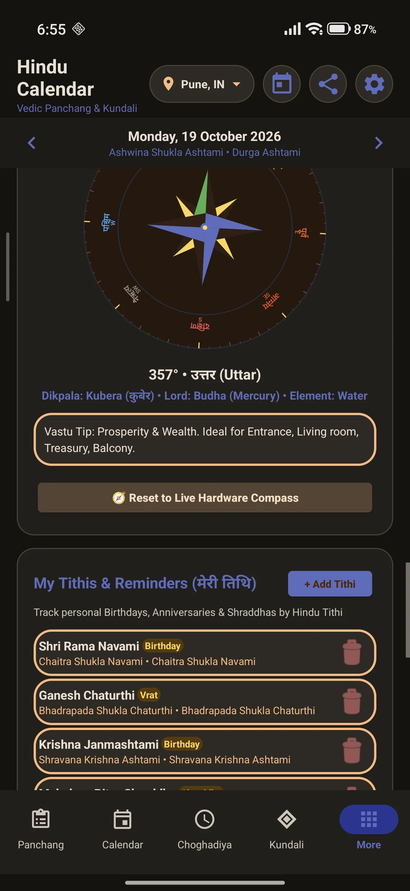
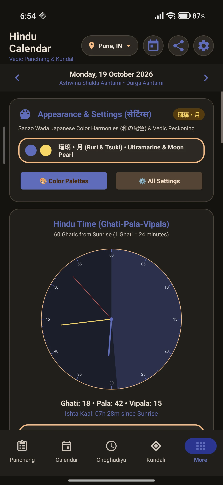
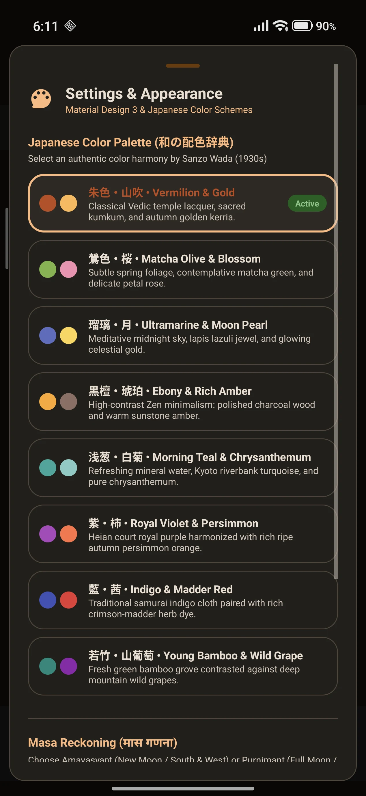
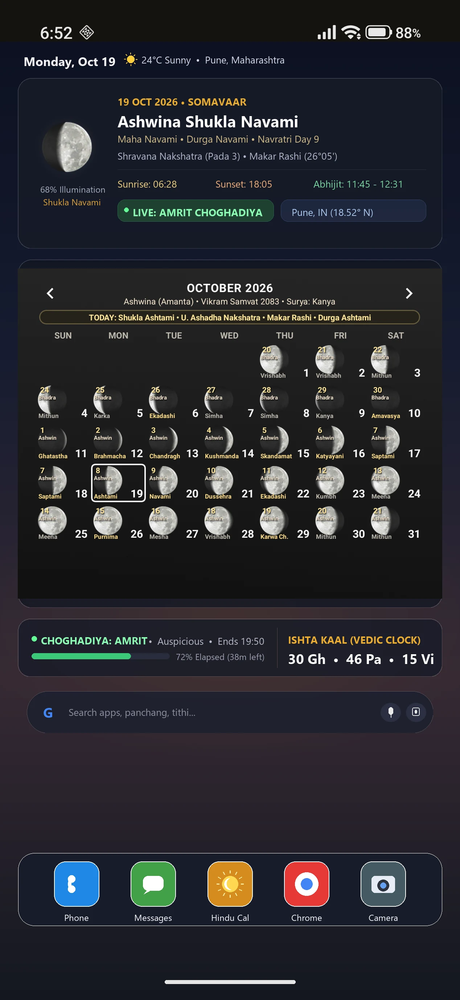

# 🕉️ Vedic Hindu Calendar & Panchang — 100% Offline, Ad-Free Android App (APK)
### (हिन्दू पंचांग, दैनिक चौघड़िया, होरा, वैदिक जन्मकुंडली एवं 16-दिशा वास्तु कंपास)

[](https://www.android.com/)
[-4CAF50.svg?style=flat&logo=android)](https://github.com/j-a-y-e-s-h/Indian-calendar/releases/tag/v1.0.0)
[](#-why-this-app-key-highlights)
[](#-why-this-app-key-highlights)
[](https://m3.material.io/)
[](#-sanzo-wada-japanese-color-harmonies-和の配色)
[](#-astronomical--vedic-ephemeris-engine)
[](#-4500-offline-global-cities-database)
[](https://j-a-y-e-s-h.github.io/Indian-calendar/)
[](LICENSE)

> **The next-generation Android Vedic Ephemeris & Panchang application**, crafted with **Material 3 Expressive Design**, fluid physics-based animations, classical **Sanzo Wada Japanese Color Harmonies**, and precision astronomical algorithms for astrologers, temple pujaris, and seekers worldwide.

---

## 📑 Table of Contents (विषय-सूची)
* [📸 Visual Showcase (एप्लिकेशन झलक)](#-visual-showcase-एप्लिकेशन-झलक)
* [⚡ Why This App? Key Highlights (प्रमुख विशेषताएँ)](#-why-this-app-key-highlights)
* [🌟 Detailed Feature Breakdown](#-core-features-प्रमुख-विशेषताएँ)
  * [1. Daily Vedic Panchanga (दैनिक पंचांग)](#1-️-daily-vedic-panchanga-दैनिक-पंचांग)
  * [2. High-Density Month Grid (मासिक कैलेंडर)](#2-️-high-density-vedic-calendar-grid-मासिक-पंचांग-कैलेंडर)
  * [3. Real-Time Choghadiya & Hora (चौघड़िया एवं होरा)](#3--real-time-choghadiya--hora-chakra-चौघड़िया-एवं-होरा-चक्र)
  * [4. Vedic Kundali & Ephemeris (जन्मकुंडली एवं ग्रह)](#4--vedic-kundali--planetary-ephemeris-वैदिक-जन्मकुंडली-एवं-ग्रह-स्थिति)
  * [5. 16-Petal Vastu Compass (वास्तु कंपास)](#5--16-petal-vedic-vastu-compass-वास्तु-शास्त्र-कंपास)
  * [6. Traditional Hindu Clock (घटी-पल घड़ी)](#6-️-traditional-hindu-clock-घटी-पल-विपल-घड़ी)
  * [7. Sanzo Wada Japanese Color Harmonies (रंग संयोजन)](#7--sanzo-wada-japanese-color-harmonies-和の配色)
  * [8. Desktop Home Screen Widgets (विजेट)](#8--transparent-material-3-desktop-home-widgets)
* [🌍 4,500+ Offline Global Cities Database](#-4500-offline-global-cities-database)
* [🛠️ Build & Installation Guide (स्थापना निर्देश)](#️-build--installation-निर्माण-एवं-स्थापना)
* [📐 Project Architecture & Codebase Structure](#-project-structure-प्रोजेक्ट-संरचना)
* [🕉️ Vedic Sanskrit Glossaries (वैदिक शब्दावली)](#️-sanskrit-terms--vedic-glossaries-वैदिक-शब्दावली)
* [❓ Frequently Asked Questions (अक्सर पूछे जाने वाले प्रश्न)](#-frequently-asked-questions-faqs)
* [🤝 Contributing & Community](#-contributing--community)
* [📄 License](#-license)

---

## ⚡ Why This App? Key Highlights
* 📴 **100% Offline & Ad-Free**: Zero cloud dependency, zero internet permissions required, zero ads, zero trackers, zero telemetry. All astronomical ephemeris calculations execute strictly on-device.
* 📦 **Lightweight Native APK (~1 MB)**: Complete offline bundle including a 4,500+ global cities database, triple Kundali charts, 16-petal Vastu compass, and 60-Ghati Hindu clock.
* 🛰️ **Precision Topocentric Ephemeris**: Exact latitude, longitude, and elevation-aware Sunrise, Sunset, Moonrise, and planetary longitudes (Lahiri / Surya Siddhanta / VSOP87).
* 🎨 **Material 3 + Sanzo Wada Aesthetics**: Full-app color harmony cascade based on early 20th-century Japanese color palettes.
* 🧭 **Multi-Tradition Support**: Amanta (South/West India) and Purnimanta (North India) reckoning, plus North/South/East Indian Kundali chart layouts.
* 🔋 **Battery Efficient**: Event-based canvas repaints, zero rogue wake-locks, and hardware-accelerated rendering.

---

## 📸 Visual Showcase (एप्लिकेशन झलक)

| 📅 1. Daily Vedic Panchang (दैनिक पंचांग) | 🗓️ 2. High-Density Month Grid (मासिक कैलेंडर) |
|:---:|:---:|
|  |  |
| **5 Limbs of Panchanga**: Tithi, Nakshatra, Yoga, Karana, Vaara, Sunrise/Sunset, Day/Night Length & Auspicious Muhurtas. | **Interactive Month Grid**: Gregorian-Vedic sync, Amanta/Purnimanta months, Navratri/Diwali/Dussehra festival badges & instant day cards. |

| ⏳ 3. Live Choghadiya & Hora (चौघड़िया एवं होरा) | 🌌 4. Kundali & 9-Graha Ephemeris (वैदिक कुंडली) |
|:---:|:---:|
|  |  |
| **Live Muhurta Timings**: Real-time Day & Night Choghadiya timeline, dynamic countdowns, Shubh/Labh/Amrit indicators & planetary Hora significance. | **Classical Kundali Charts**: North Indian Diamond, South Indian Square, and East Indian Bangla charts with Shadbala, Ashtakavarga SAV & Sade Sati. |

| 🧭 5. 16-Petal Vedic Vastu Compass (वास्तु कंपास) | ⏰ 6. Vedic Ghati Clock (घटी-पल-विपल घड़ी) |
|:---:|:---:|
|  |  |
| **Vastu Shastra Compass**: Classical 16 petals, 8 Ashtadikpalas (Indra, Agni, Yama, Nirrti, Varuna, Vayu, Kubera, Ishana), planetary lords & architectural tips. | **Traditional Hindu Clock**: 60 Ghatis from Sunrise (1 Ghati = 24m), Pala, Vipala, and exact Ishta Kaal calculation. |

| ⚙️ 7. Material 3 Settings (सेटिंग्स एवं विकल्प) | 📱 8. Desktop Home Screen Widgets (विजेट) |
|:---:|:---:|
|  |  |
| **Centralized Control**: 8 Sanzo Wada Japanese Palettes, Amanta/Purnimanta Masa, Lahiri/Raman/KP Ayanamsa, JSON Backup/Restore & 1-Tap Widget Pinning. | **Transparent Desktop Widgets**: Glaze-transparent Month Calendar Grid and compact Daily Panchang pill directly on your Android home screen. |

---

## 🌟 Core Features (प्रमुख विशेषताएँ)

### 1. 🕉️ Daily Vedic Panchanga (दैनिक पंचांग)
* **The Five Sacred Limbs (पंचांग के 5 अंग)**:
  * **Tithi (तिथि)**: Real-time lunar day (Shukla Pratipada to Purnima / Krishna Amavasya) with exact sub-minute completion timestamps and progress percentage.
  * **Nakshatra (नक्षत्र)**: 27 Vedic constellations (Ashwini to Revati), Pada (चरण 1 to 4), and ruling Graha Swami.
  * **Yoga (योग)**: 27 Nitya Yogas (Vishkambha to Vaidhriti) calculated from longitudinal Sun-Moon angular summation.
  * **Karana (करण)**: 11 Karanas (Bava, Balava, Kaulava, Taitila, Gara, Vanija, Vishti/Bhadra, Shakuni, Chatushpada, Naga, Kintughna) with precise transition timings.
  * **Vaara (वार)**: Vedic weekday governed by planetary rulers (Surya, Chandra, Mangal, Budh, Guru, Shukra, Shani).
* **Surya & Chandra Ephemeris (सूर्य-चन्द्र उदय एवं अस्त)**:
  * Topocentric Sunrise, Sunset, Moonrise, and Moonset based on observer coordinates.
  * Day length (दिनमान) and Night length (रात्रिमान) dynamically calculated for all latitudes.
  * Real-time Moon Phase illumination percentage and high-resolution render.
* **Shubh & Ashubh Muhurtas (शुभ एवं अशुभ मुहूर्त)**:
  * **Abhijit Muhurta (अभिजित मुहूर्त)**: The most auspicious midday window (15th part of daytime).
  * **Brahma Muhurta (ब्रह्म मुहूर्त)**: Sacred predawn window for sadhana, meditation, and mantras.
  * **Rahu Kaal (राहुकाल)**, **Yamaganda (यमगण्ड)**, and **Gulika Kaal (गुलिक काल)** with color-coded safety indicators.
  * **Vijaya Muhurta**, **Godhuli**, **Amrit Kaal**, and **Nishita Kaal** for midnight ceremonies.
* **Lagna Table of the Day (दैनिक लग्न तालिका)**:
  * Comprehensive table of all 12 rising signs (Mesha to Meena) for the day, marked with live status indicators.

---

### 2. 🗓️ High-Density Vedic Calendar Grid (मासिक पंचांग कैलेंडर)
* **Dual Month Reckoning (अमान्त एवं पूर्णिमान्त मास)**:
  * Toggle effortlessly between **Amanta** (Southern and Western tradition: Gujarat, Maharashtra, Karnataka, Andhra Pradesh, Tamil Nadu, Kerala) and **Purnimanta** (Northern tradition: UP, Bihar, Rajasthan, MP, Punjab, Delhi).
* **Integrated Festival & Vrat Engine (त्यौहार एवं व्रत)**:
  * Covers 80+ major Sanatana Dharma festivals: Diwali, Durga Ashtami, Dussehra, Karwa Chauth, Sharad Purnima, Maha Shivaratri, Janmashtami, Rama Navami, Ekadashi Vrats, Pradosh Vrats, and Sankranti.
  * Dual-row festival pill badges with intelligent line wrapping and overflow handling.
* **Seamless Date Navigation**:
  * Dynamic Gregorian-to-Saka/Vikram Samvat conversion.
  * Instant day jumping, today reset button, and swipe navigation.

---

### 3. ⏳ Real-Time Choghadiya & Hora Chakra (चौघड़िया एवं होरा चक्र)
* **Choghadiya Muhurtas (चौघड़िया)**:
  * Full Day (दिन का चौघड़िया) and Night (रात का चौघड़िया) divisions.
  * 7 Choghadiyas: **Amrit (अमृत)**, **Shubh (शुभ)**, **Labh (लाभ)**, **Char (चर)**, **Rog (रोग)**, **Kaal (काल)**, and **Udveg (उद्वेग)**.
  * Live hero card showing the currently active period with ticking countdown timer (`Ends in mm:ss`).
* **Planetary Hora Chakra (होरा चक्र)**:
  * Classical 24-hour planetary sequence starting from the lord of the weekday.
  * Auspiciousness ratings and practical task recommendations for each Hora.

---

### 4. 🌌 Vedic Kundali & Planetary Ephemeris (वैदिक जन्मकुंडली एवं ग्रह स्थिति)
* **Triple Regional Chart Formats**:
  1. **North Indian (उत्तर भारतीय)**: Classical diamond style where houses are fixed and zodiac signs rotate.
  2. **South Indian (दक्षिण भारतीय)**: Fixed-sign 4x4 square chart where signs are fixed and Ascendant (Lagna) rotates clockwise.
  3. **East Indian (पूर्व भारतीय / बांग्ला)**: Classical triangular layout widely used in Bengal, Odisha, and Assam.
* **9 Vedic Grahas + Outer Planets**:
  * Surya, Chandra, Mangal, Budh, Guru, Shukra, Shani, Rahu, Ketu, plus Uranus (Arun), Neptune (Varun), and Yama.
  * Accurate degrees, retrograde status (वक्र गति `R`), Nakshatra, and Pada.
* **Advanced Parashari Tools**:
  * **Avakahada Chakra (अवकहड़ा चक्र)**: Janma Rashi, Rashi Lord, Nakshatra Swami, Varna, Vashya, Yoni, Gana, Nadi, Paya, and Janma Akshara.
  * **Sarvashtakavarga (सर्वाष्टकवर्ग SAV)**: 12-house bindu score analysis with strength evaluation (Strongest vs Weakest house vs 28-bindu baseline).
  * **Shadbala (षड्बल)**: Comprehensive 6-fold planetary strength calculation (Sthana, Dig, Kala, Chesta, Naisargika, Drik bala) in Rupas and strength ratios.
  * **Shani Sade Sati Status (शनि साढ़े साती)**: Real-time phase detection (Rising, Peak, Setting, or Free).
  * **Ashtakoota 36-Guna Milan (अष्टकूट गुण मिलान)**: Complete matrimonial compatibility algorithm evaluating Varna (1), Vashya (2), Tara (3), Yoni (4), Graha Maitri (5), Gana (6), Bhakoot (7), and Nadi (8).

---

### 5. 🧭 16-Petal Vedic Vastu Compass (वास्तु शास्त्र कंपास)
* **Ashtadikpala Architectural System**:
  * **North (उत्तर - Kubera)**: Wealth, prosperity, treasury, study, water element.
  * **North-East (ईशान - Shiva/Ishana)**: Meditation, pooja room, sacred altar, northeast water tank.
  * **East (पूर्व - Indra)**: Main entrance, solar vitality, guest reception, intellect.
  * **South-East (आग्नेय - Agni)**: Kitchen, fire element, heating, transformers.
  * **South (दक्षिण - Yama)**: Master bedroom, stability, legal storage.
  * **South-West (नैऋत्य - Nirrti)**: Heavy storage, master bedroom, earthly anchors.
  * **West (पश्चिम - Varuna)**: Dining hall, overhead tanks, study rooms.
  * **North-West (वायव्य - Vayu)**: Guest room, finished goods, air circulation.
* **Hardware & Manual Control**:
  * Seamlessly reads rotation vector, accelerometer, and magnetometer sensors.
  * Manual drag-to-inspect mode with instant 1-tap reset to live hardware compass.

---

### 6. ⏰ Traditional Hindu Clock (घटी-पल-विपल घड़ी)
* Divides the 24-hour solar cycle into **60 Ghatis** beginning at local Sunrise.
* `1 Ghati = 24 Minutes`, `1 Pala = 24 Seconds`, `1 Vipala = 0.4 Seconds`.
* Visual analog 60-Ghati dial with daytime and nighttime arcs, live sweeping hands, and exact **Ishta Kaal (इष्टकाल)** display.

---

### 7. 🎨 Sanzo Wada Japanese Color Harmonies (和の配色)
Inspired by legendary artist and costume designer **Sanzo Wada's 1930s masterwork** (*A Dictionary of Color Combinations* / 配色総鑑), the app features 8 expressive palettes:

1. **鴬・桜 (Uguisu & Sakura)**: Japanese bush warbler olive paired with delicate spring cherry blossom pink.
2. **瑠璃・月 (Ruri & Tsuki)**: Meditative midnight sky, lapis lazuli jewel, and celestial moon gold.
3. **黒檀・琥珀 (Kokutan & Kohaku)**: Zen minimalism: polished charcoal ebony wood and warm amber.
4. **浅葱・白菊 (Asagi & Shiragiku)**: Kyoto riverbank turquoise and pure white chrysanthemum.
5. **紫・柿 (Murasaki & Kaki)**: Heian court royal Edo violet harmonized with autumn persimmon orange.
6. **藍・茜 (Ai & Akane)**: Traditional samurai indigo cloth paired with rich crimson-madder herb dye.
7. **若竹・山葡萄 (Wakatake & Yamabudou)**: Fresh young green bamboo contrasted against deep wild mountain grape.
8. **松・紅梅 (Matsu & Koubai)**: Ancient evergreen pine forest paired with winter red plum blossom.

> Changing palettes dynamically updates navigation pills, card highlights, canvas dials (Compass, Kundali, Clock, Muhurta Timeline), and text elements with fluid spring transitions.

---

### 8. 📱 Transparent Material 3 Desktop Home Widgets
* **4x4 Month Calendar Grid Widget**:
  * Transparent background designed to blend seamlessly with any wallpaper.
  * Live Gregorian date, Hindu month name, Vikram Samvat, Tithi labels, moon phases, and highlighted current day.
* **4x2 Daily Panchang Widget**:
  * Compact glanceable view with active Tithi, Nakshatra, Sunrise, Sunset, and current Choghadiya.

---

## 🌍 4,500+ Offline Global Cities Database
* Bundled with a compressed topocentric coordinates database (`assets/cities.json.gz`).
* Pre-configured with major Indian cities (Pune, Mumbai, Delhi, Varanasi, Ujjain, Chennai, Kolkata, Bengaluru) and global metropolises across the USA, UK, Canada, Australia, UAE, Europe, and Asia.
* Instant sub-millisecond search with automatic latitude, longitude, and timezone resolution.

---

## 🛠️ Build & Installation (निर्माण एवं स्थापना)

### Prerequisites
* Windows 10/11 or macOS/Linux
* Java Development Kit (JDK 11 or higher)
* Android SDK build-tools (`aapt2`, `d8`, `zipalign`, `apksigner`)

### Standalone 1-Click PowerShell Build (Windows)
The repository includes a self-contained build script configured with standalone tools:
```powershell
# Clone the repository
git clone https://github.com/j-a-y-e-s-h/Indian-calendar.git
cd Indian-calendar

# Run automated compile, DEX, APK packaging, zipalign & signing
powershell -ExecutionPolicy Bypass -File .\CustomHinduWidget\build.ps1
```
The production-ready signed APK is generated at:
```text
output\com.custom.hinduwidget.apk
```

### Install directly via ADB
```powershell
adb install -r output\com.custom.hinduwidget.apk
adb shell am start -n com.custom.hinduwidget/.MainActivity
```

---

## 📐 Project Structure (प्रोजेक्ट संरचना)

```text
Indian-calendar/
├── CustomHinduWidget/
│   ├── assets/
│   │   └── cities.json.gz               # 4,500+ offline global cities dataset
│   ├── res/
│   │   ├── drawable/                     # Material 3 drawables, badges, pills, moon phases
│   │   ├── layout/                       # Tab Panchang, Calendar, Choghadiya, Kundali, More, Widgets
│   │   ├── values/                       # Colors, styles, dimensions, Sanskrit strings
│   │   └── xml/                          # Widget metadata specifications
│   ├── src/com/custom/hinduwidget/
│   │   ├── MainActivity.java             # Main controller, tab management, dynamic themes
│   │   ├── PanchangCalculator.java       # Ephemeris, 5 limbs, Muhurtas, Shadbala, Ashtakavarga
│   │   ├── ThemeManager.java             # Sanzo Wada Japanese color palettes & drawable generators
│   │   ├── CityManager.java              # Fast gzip city search & coordinate resolver
│   │   ├── VedicCompassView.java         # 16-petal canvas Vastu compass with sensor integration
│   │   ├── HinduClockView.java           # 60-Ghati analog dial canvas view
│   │   ├── NorthIndianKundaliView.java   # Diamond chart canvas view
│   │   ├── SouthIndianKundaliView.java   # Square chart canvas view
│   │   ├── EastIndianKundaliView.java    # Bangla chart canvas view
│   │   ├── VisualMuhurtaTimelineView.java# 24-hour visual Muhurta timeline view
│   │   ├── MonthCalendarWidgetProvider.java # 4x4 Home screen month widget
│   │   └── DailyPanchangWidgetProvider.java # 4x2 Home screen daily widget
│   ├── AndroidManifest.xml               # App & Widget permissions, receiver definitions
│   └── build.ps1                         # Standalone automated build & sign pipeline
├── screenshots/                          # High-resolution showcase screenshots for README
├── keystore/                             # Release signing keystore
├── tools/                                # AAPT2, D8, Zipalign binaries
├── lib/                                  # android.jar API stubs
├── .gitignore                            # Clean production gitignore
└── README.md                             # Comprehensive SEO & bilingual documentation
```

---

## 🕉️ Sanskrit Terms & Vedic Glossaries (वैदिक शब्दावली)

| Sanskrit Term | Hindi (हिन्दी) | Meaning & Astronomical Significance |
|:---|:---|:---|
| **Panchanga** | पंचांग | The five limbs of time: Tithi, Vaara, Nakshatra, Yoga, Karana. |
| **Tithi** | तिथि | Lunar phase division (12° angular distance between Sun and Moon). |
| **Nakshatra** | नक्षत्र | 13°20' lunar mansion of the ecliptic (27 divisions). |
| **Choghadiya** | चौघड़िया | A period of approximately 1.5 hours (3.75 Ghatis) for calculating auspiciousness. |
| **Kundali** | जन्मकुंडली | Vedic astrological birth chart showing celestial planetary positions. |
| **Vastu Shastra** | वास्तु शास्त्र | Traditional Hindu system of architecture and directional alignment. |
| **Ashtadikpala** | अष्टदिक्पाल | Guardians of the eight directional points of the universe. |
| **Ghati** | घटी | Ancient unit of time equal to 24 standard minutes (1/60th of a day). |
| **Ayanamsa** | अयनांश | Angular difference between Tropical and Sidereal zodiacs (Lahiri / Chitra Paksha). |

---

## ❓ Frequently Asked Questions (FAQs)

<details>
<summary><b>1. What is the difference between Amanta and Purnimanta month systems? (अमान्त और पूर्णिमान्त मास में क्या अंतर है?)</b></summary>
<br>
In Indian astronomy, lunar months are counted by two primary traditions:
* <b>Amanta (अमान्त)</b>: The lunar month ends on <i>Amavasya</i> (New Moon). Followed widely in Gujarat, Maharashtra, Karnataka, Andhra Pradesh, Telangana, Tamil Nadu, and Kerala.
* <b>Purnimanta (पूर्णिमान्त)</b>: The lunar month ends on <i>Purnima</i> (Full Moon). Followed in Northern and Central India (Uttar Pradesh, Bihar, Rajasthan, Madhya Pradesh, Punjab, Haryana, Delhi, Himachal Pradesh).
<br>
The app allows instantaneous 1-tap switching between Amanta and Purnimanta from the centralized Settings modal.
</details>

<details>
<summary><b>2. How are Choghadiya and Hora timings calculated for any location? (चौघड़िया एवं होरा मुहूर्त की गणना कैसे होती है?)</b></summary>
<br>
Choghadiya is not fixed to arbitrary wall-clock hours; it is strictly topocentric:
* <b>Day Choghadiya (दिन का चौघड़िया)</b>: The exact interval between local Sunrise and local Sunset is divided into <b>8 equal periods</b> (each approximately 1.5 hours or 3.75 Ghatis). The 8th period is ruled by the lord of the next sunset.
* <b>Night Choghadiya (रात का चौघड़िया)</b>: The interval between Sunset and the following day's Sunrise is divided into 8 equal periods.
* <b>Planetary Hora (होरा)</b>: Each day is divided into 24 planetary hours beginning with the ruler of the day at Sunrise.
</details>

<details>
<summary><b>3. Does this app require an internet connection or GPS? (क्या यह पंचांग बिना इंटरनेट के काम करता है?)</b></summary>
<br>
<b>No.</b> The app is 100% offline. It bundles a compressed database of over <b>4,500+ global cities</b> with exact geographical coordinates, timezones, and elevation offsets. All celestial trigonometry, planetary ephemeris, and Tithi-Nakshatra transitions are calculated natively on your device CPU with zero network requests.
</details>

<details>
<summary><b>4. Which Ayanamsa systems are supported for Vedic Kundali? (कुंडली के लिए कौन सा अयनांश प्रयोग किया जाता है?)</b></summary>
<br>
The app supports:
* <b>Lahiri / Chitra Paksha (चित्रपक्षीय लाहिड़ी अयनांश)</b> — The official Indian Government standard and most widely accepted system by Parashari astrologers.
* <b>B.V. Raman Ayanamsa</b> — Popularized by Dr. B.V. Raman.
* <b>KP (Krishnamurti Padhdhati) Ayanamsa</b> — Used for sub-lord precision astrology.
</details>

<details>
<summary><b>5. Where can I download the free, offline, ad-free Vedic Hindu Calendar APK? (फ्री एवं विज्ञापन-मुक्त ऑफ़लाइन पंचांग APK कहाँ से डाउनलोड करें?)</b></summary>
<br>
You can download the production-ready universal APK directly from <a href="https://github.com/j-a-y-e-s-h/Indian-calendar/releases/tag/v1.0.0"><b>GitHub Releases v1.0.0 (vedic-hindu-calendar-v1.0.0.apk)</b></a>. It is ~1 MB in size, completely open source, has zero trackers, displays zero ads, requires zero internet access, and runs on any Android phone or tablet with Android 8.0 or higher.
</details>

<details>
<summary><b>6. How do I add the transparent Vedic widgets to my Android home screen? (होम स्क्रीन पर विजेट कैसे लगाएं?)</b></summary>
<br>
1. Long-press any empty space on your Android home screen.
2. Select <b>Widgets (विजेट)</b>.
3. Scroll to <b>Vedic Hindu Calendar</b>.
4. Choose either the <b>Month Calendar Grid (4x4)</b> or <b>Daily Panchang Pill (4x2)</b> and drag it to your screen.
<br>
<i>Tip: You can also open the app's Settings modal and tap "Pin Month Widget" or "Pin Daily Widget" for 1-tap launcher placement on Android 8.0+.</i>
</details>

---

## 🤝 Contributing & Community
Contributions, bug reports, and suggestions from Vedic scholars, Sanskrit linguists, and Android developers are welcome!
* Star the repository on GitHub: ⭐ [Indian-calendar](https://github.com/j-a-y-e-s-h/Indian-calendar)
* Open an Issue for feature requests or astronomical calculation queries.
* Pull requests are warmly welcomed for localized translations and regional festival additions.

---

## 📄 License
This project is licensed under the Apache License 2.0. Open-source for the global Sanatana Dharma and Vedic astrology community.

---
*Created with devotion and engineering excellence for Vedic scholars and practitioners across the globe.*
